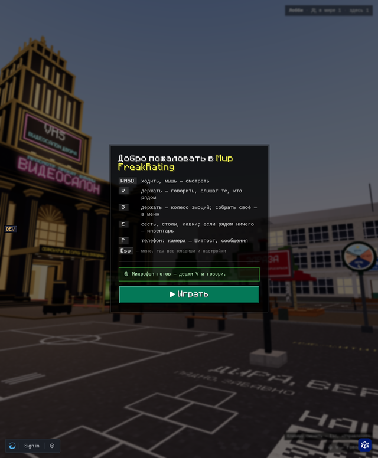

# FreakRating — клиент мира

Десктоп-клиент 3D-мира [FreakRating](https://freakrating.lol/world) на Electron.
Тонкая оболочка: окно грузит `https://freakrating.lol/world`, мир обновляется
деплоем сайта, клиент — редко.

Зачем, если есть браузер:

- **Видеокарта.** На ноутбуках с двумя видеокартами просит мощную; игнорирует
  чёрный список GPU Chromium (частая причина чёрного экрана); графический
  режим (Direct3D 11 / Vulkan / OpenGL) выбирается в настройках.
- **Падения.** Упал GPU-процесс или страница, страница зависла на 10 с —
  мир перезагружается на тот же адрес. После двух падений подряд клиент
  предлагает другой графический режим.
- **Диагностика.** Метрики процессов, полный GPU-info, локальные дампы падений —
  страница забирает их в отчёт «У меня лагает».
- **Рация в фоне.** Глобальная клавиша (по умолчанию F8 или боковая кнопка
  мыши) работает, даже когда окно свёрнуто.
- **Без случайностей.** Ctrl+W, Ctrl+T, Ctrl+R, F5 не закрывают и не
  перезагружают мир; закрытие окна — с подтверждением.
- **Звук без клика**, без фонового троттлинга, **статус в Discord**.



Сайт узнаёт клиент по `window.freakClient` — контракт в [docs/API.md](docs/API.md).

## Запуск из исходников

Нужен Node.js 22+.

```bash
npm install
npm start                      # против freakrating.lol
npm run dev                    # против http://localhost:4000/world
```

Свой адрес: `npx electron . --url=http://localhost:4172/world` или переменная
`FREAK_URL`. Адрес из `--url` считается «своим»: на него пускают навигацию и
отдают `window.freakClient`.

Прочие флаги:

| Флаг / переменная | Что |
|---|---|
| `--graphics-backend=d3d11\|vulkan\|gl\|auto`, `FREAK_GRAPHICS_BACKEND` | бэкенд на этот запуск, мимо настроек |
| `--devtools` | открыть инструменты разработчика |
| `FREAK_DISCORD_CLIENT_ID` | Discord Application ID мимо `src/main/config.ts` |

## Проверка с дев-сервером freakland

1. Дев-сервер freakland поднят на :4000 (`bin/dev-up` в freakland).
2. `npm run dev` — откроется окно с миром.
3. Вход: в окне клиента нажмите Ctrl+Shift+F12 (DevTools) и выполните
   `location.href = "/dev/login/ВашНик?to=world"` — или запустите
   `node scripts/smoke.mjs --as=ВашНик` (Playwright сам войдёт, напечатает
   `freakClient` и снимет `smoke.png`).
4. Проверить API в консоли страницы:
   ```js
   await freakClient.getSettings()
   await freakClient.getDiagnostics()
   freakClient.onPtt(s => console.log("рация", s))
   ```
5. Падение GPU: `kill -9 <pid>` процесса `GPU` (pid — в
   `getDiagnostics().appMetrics`). Мир перезагрузится на тот же адрес,
   `onCrashRecovered` придёт со `streak`; второе падение подряд — диалог
   с другим графическим режимом (на Wayland предлагать нечего — только OpenGL).

Юнит-тесты чистой логики: `npm test`.

## Настройки клиента

Ctrl+, в окне мира или значок в трее → «Настройки клиента». Там графический
режим (применяется перезапуском, кнопка «Перезапустить» вернёт в тот же мир),
«Мощная видеокарта», клавиша рации, копирование диагностики, папка дампов.

Хранятся в `settings.json` в папке данных: Windows —
`%APPDATA%\FreakRating`, Linux — `~/.config/FreakRating`. Дампы падений —
там же, `Crashpad/`.

## Рация в фоне

- **Windows и Linux/X11** — системный хук [uiohook-napi](https://github.com/SnosMe/uiohook-napi):
  видит нажатие и отпускание любой клавиши и боковых кнопок мыши. «Назначить»
  в настройках ждёт следующую клавишу (Esc — отмена).
- **Linux/Wayland** (Hyprland и др.) — хуков нет: Wayland не отдаёт приложению
  чужие нажатия. `globalShortcut` Electron тоже не годится: он сообщает только
  нажатие, а на Hyprland через портал вообще ничего не регистрирует (проверено
  на Hyprland 0.56, Electron 44). Поэтому клиент слушает именованный канал
  `$XDG_RUNTIME_DIR/freakrating-ptt`, а нажатие и отпускание шлёт композитор.
  Для Hyprland в `~/.config/hypr/hyprland.conf`:
  ```
  bind  = , F8, exec, timeout 1 sh -c 'echo down > "$XDG_RUNTIME_DIR/freakrating-ptt"'
  bindr = , F8, exec, timeout 1 sh -c 'echo up > "$XDG_RUNTIME_DIR/freakrating-ptt"'
  ```
  Боковая кнопка мыши — `mouse:275`/`mouse:276` вместо `F8`. Sway —
  `bindsym F8 exec …` и `bindsym --release F8 exec …`.
  Без биндов рация работает, пока окно в фокусе, — клавишей из настроек мира.

## Сборка

```bash
npm run dist:win     # release/FreakRating-Setup-<версия>.exe (NSIS, x64)
npm run dist:linux   # release/FreakRating-<версия>-x86_64.AppImage и .deb
```

Windows-установщик собирается на Windows (или в CI). На Linux его можно
собрать через wine, но проще CI.

### Релиз

Сборки делает GitHub Actions (`.github/workflows/release.yml`) на
`windows-latest` и `ubuntu-latest` по тегу:

```bash
npm version 0.1.1          # поднимает package.json и ставит тег v0.1.1
git push --follow-tags
```

Workflow создаёт **черновик** релиза с `.exe`, `.AppImage`, `.deb` —
опубликовать руками после проверки.

Код не подписан: Windows SmartScreen покажет «Система Windows защитила ваш
компьютер» → «Подробнее» → «Выполнить в любом случае».

## Устройство

| Файл | Что |
|---|---|
| `src/main/main.ts` | окно, падения, IPC, настройки, старт |
| `src/main/config.ts` | адрес мира, allowlist, Discord client id, пороги падений |
| `src/main/navigation.ts` | куда окну можно ходить (Twitch — только во время входа) |
| `src/main/gpu.ts` | флаги Chromium, «мощная видеокарта» в реестре Windows |
| `src/main/ptt.ts` | рация: uiohook и канал для Wayland |
| `src/main/discord.ts` | Rich Presence |
| `src/main/diagnostics.ts` | метрики, GPU-info, дампы |
| `src/preload/preload.ts` | `window.freakClient` |
| `src/settings/` | окно настроек клиента |

Безопасность: `contextIsolation`, `sandbox`, `nodeIntegration: false`, без
`<webview>`; главный фрейм ходит только по `freakrating.lol` (и поддоменам),
`freakland.egorrko.ru` и адресу из `--url`; Twitch — только внутри входа через
`id.twitch.tv`; всё прочее открывается в системном браузере. IPC принимает
вызовы только от окна мира на своём адресе и от окна настроек.
